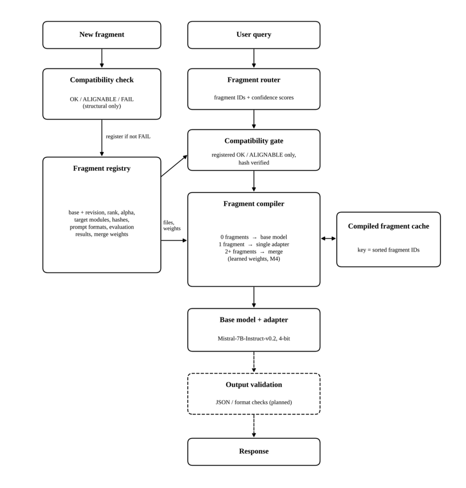

# AI Model Fragment Compiler

**Composing modular LoRA skills on a shared language model.**

One frozen base model, many small skill adapters ("fragments"). A router reads each query and picks the fragments it needs. A compiler then loads the base model alone, one adapter, or a merged adapter built on the fly and cached for reuse.
---

## Table of Contents
1. [Motivation](#motivation)
2. [System Architecture](#system-architecture)
3. [Fragments (Adapters)](#fragments-adapters)
4. [Merging Methods](#merging-methods)
5. [Results](#results)
6. [Repository Structure](#repository-structure)
7. [Getting Started](#getting-started)
8. [Reproducing the Experiments](#reproducing-the-experiments)
9. [Limitations and Future Work](#limitations-and-future-work)
10. [References](#references)

---

## Motivation

Fine-tuning a separate 7B model for every skill wastes memory, storage and training time. LoRA adapters solve part of this: each skill is a small low-rank update on a shared frozen base model. Real queries, however, often need **more than one skill at once**. For example, a single query can ask the model to extract fields as JSON *and* reply in a polite support tone.

This project treats adapters as **composable building blocks**:

- **Registry.** Each adapter is registered with its metadata and a compatibility key.
- **Compatibility check.** Every adapter is checked against the base model before it is used.
- **Router.** A lightweight router decides which adapters a query needs.
- **Compiler.** The selected adapters are merged at query time, and the merged result is cached.

The main experimental question is: **which merging method best keeps each adapter's individual gains when several adapters are combined into one?**

---

## System Architecture

<p align="center"></p>

**Registration path:** a new fragment goes through the compatibility check and is then added to the fragment registry.

The compatibility check returns one of three results:

| Result | Meaning |
|---|---|
| `OK` | Same base model, revision, rank and target modules. |
| `ALIGNABLE` | Same base model, but fewer target modules. The missing modules are zero-filled so the adapter can still be merged. |
| `FAIL` | Different base model or revision. The fragment is rejected. |

**Query path:** user query → fragment router → compatibility gate → fragment compiler → base model + adapter → response.

The fragment compiler takes one of three paths, depending on how many fragments the router picked:

| Fragments selected | What the compiler does |
|---|---|
| 0 | Plain base model |
| 1 | That fragment's original adapter, unchanged |
| 2 or more | Concatenation merge using learned (M4) weights. The result is cached, so the same combination is never merged twice. |

**Prompt contracts:** each fragment declares the prompt format it was trained on. For example, the SQL and SAMSum adapters use the SuperNI instruction format and the tone adapter uses a `Subject: …` template. The pipeline wraps the query in that format before generation.

---

## Fragments (Adapters)

All fragments share the same base model and LoRA settings:

- **Base model:** `mistralai/Mistral-7B-Instruct-v0.2` (revision `63a8b081`), loaded in 4-bit NF4 with double quantisation.
- **LoRA settings:** r = 16, α = 32.

| Fragment | Skill | Source | Target modules | Compatibility |
|---|---|---|---|---|
| `json` | Extract fields from text as structured JSON | Trained by us | q, k, v, o, gate, up, down | OK |
| `tone` | Rewrite support replies in a polite, professional tone | Trained by us | q, k, v, o, gate, up, down | OK |
| `sql` | Text → SQL (SuperNI task107) | Lots-of-LoRAs | q, k, v | ALIGNABLE |
| `samsum` | Dialogue summarisation (SuperNI task1572) | Lots-of-LoRAs | q, k, v | ALIGNABLE |

The two adapters we trained are hosted on the Hugging Face Hub (the weights are 167 MB each, too large for GitHub):

- JSON adapter: `https://huggingface.co/<hf-username>/json-extract-lora`
- Tone adapter: `https://huggingface.co/<hf-username>/support-reply-tone-lora`

---

## Merging Methods

All 4 adapters were merged into a single adapter with each of these methods:

| ID | Method | Idea |
|---|---|---|
| M1 | Concatenation merge | Stack the LoRA A and B matrices into one rank-64 adapter, scaled by λ. Exact, with no approximation. |
| M2 | TIES | Trim small updates, elect a sign per parameter, and keep only values that agree with it. Projected back to rank 64 with SVD. |
| M3 | DELLA | Magnitude-based random dropping with rescaling. Projected back to rank 64 with SVD. |
| M4 | Learned weights (LoraHub-style) | One weight per adapter, found by gradient-free search (Nevergrad NGOpt, 30 trials) on development loss. |
| M5 | Core Space + TSV | Merge inside a shared low-rank core space, with task-singular-vector interference reduction. |
| M6 | Core Space + Iso-C | Core-space merge that flattens the singular-value spectrum. |
| M7 | Norm-balanced merge | Rescale each adapter to equal norm before merging. |

**Metric: Gain Retention (GR).** GR measures how much of an adapter's solo improvement over the base model survives after merging:

```
GR = (merged − base) / (solo − base)
```

For the tone adapter, where lower loss is better, the formula is flipped: `GR = (base − merged) / (base − solo)`.

- GR = 1.0 means the merge keeps 100% of the solo gain.
- GR < 0 means the merged model does worse than the base model.

---

## Results

### 1. Base model vs single adapter (full test sets)

| Task (n) | Metric | Base | Solo adapter |
|---|---|---|---|
| JSON (70) | Field F1 | 0.369 | **0.662** |
| JSON (70) | Parse rate | 58.6% | **82.9%** |
| SQL (204) | ROUGE-L | 0.500 | **0.737** |
| SQL (204) | Exact match | 0.010 | **0.113** |
| SAMSum (150) | ROUGE-L | 0.312 | **0.418** |
| Tone (150) | Loss (↓) | 2.832 | **1.663** |

### 2. Merging all 4 adapters (development subset)

The table shows the best setting found for each method:

| Method | Setting | Avg GR | Worst-task GR |
|---|---|---|---|
| **M4 Learned weights** | NGOpt, 30 trials | **1.02** | **0.85** |
| M1 Concatenation | λ = 0.5 | 0.98 | 0.83 |
| M2 TIES | density 0.2 | 0.95 | 0.77 |
| M5 Core + TSV | α = 0.5 | 0.95 | 0.87 |
| M7 Norm-balanced | — | 0.93 | 0.64 |
| M3 DELLA | density 0.5 | 0.92 | 0.62 |
| M6 Core + Iso-C | α = 1.0 | 0.40 | −1.16 |

The learned M4 weights were: json 0.538, tone 0.377, sql 0.941, samsum 0.674.

### 3. Held-out test (never used for tuning)

| Method | Avg GR | Worst-task GR |
|---|---|---|
| **M4 Learned weights** | **0.86** | **0.80** |
| M1 Concatenation (λ = 0.5) | 0.84 | 0.80 |
| M5 Core + TSV (α = 0.5) | 0.70 | 0.50 |

Per-task GR for M4 was JSON 0.80, SQL 0.89 and SAMSum 0.90. The M4 result reproduced across two independent runs.

### 4. Router and end-to-end system

The router uses `all-MiniLM-L6-v2` embeddings and logistic regression over 5 classes: json, tone, sql, samsum and none.

| Router | Value |
|---|---|
| Overall accuracy | **94.4%** |
| Per-class accuracy | json 1.00 · tone 1.00 · sql 0.92 · samsum 0.94 · none 0.86 |
| Latency | 8.3 ms per query |

End-to-end GR for two strategies: always loading the merged all-4 adapter, and routing each query to only the fragments it needs.

| Task | Always all-4 merged | Routed (our system) |
|---|---|---|
| JSON | 0.89 | **1.00** |
| SQL | 1.25 | 0.83 |
| SAMSum | 0.70 | **0.95** |
| Tone | 1.25 | 1.00 |

Other measurements:

- Peak GPU memory: 7.74 GB.
- Merged all-4 adapter size: 671 MB.
- Merging JSON + Tone takes 2.93 s, and the merged adapter is cached after the first build.

---

## Repository Structure

```
.
├── README.md
├── .gitignore
├── notebooks/
│   ├── 01_train_json_adapter.ipynb      # JSON extraction adapter training
│   ├── 02_train_tone_adapter.ipynb      # Support-reply tone adapter training
│   ├── 03_phase1_baselines.ipynb        # Base vs solo evaluation on all 4 tasks
│   ├── 04_scoring_and_merging.ipynb     # M1–M7 merges, M4 search, held-out run
│   ├── 05_results.ipynb                 # Summary tables and charts
│   └── 06_router_pipeline.ipynb         # Registry, router, compiler, end-to-end test
├── adapters/
│   ├── json-extract-lora/               # config, tokenizer, registry entry (weights on HF)
│   └── support-reply-tone-lora/         # config, tokenizer, registry entry (weights on HF)
├── results/
│   ├── experiment_checkpoint/           # eval datasets, base/solo outputs, manifest, metadata
│   ├── phase2_results/                  # all merge outputs, scores, M4 weights, held-out summary
│   ├── phase3_results/                  # registry, router model and eval, end-to-end results
│   └── final_tables/                    # CSV summaries and charts
├── eval/
│   ├── json_reference.json              # JSON gold references
│   ├── judge_audit.json                 # Blind tone audit sheet
│   └── judge_audit_key.json             # Answer key for the audit
└── docs/
    ├── architecture.jpg
    ├── AI_Model_Fragment_Compiler_Final_Report.pdf
    └── MajorProject_MidTerm_Report.pdf
```

---

## Getting Started

### Requirements
- Python 3.10+
- A GPU with at least 8 GB VRAM (peak usage was 7.74 GB). All experiments ran on Kaggle GPUs.

```bash
pip install torch transformers peft bitsandbytes accelerate datasets \
            sentence-transformers scikit-learn nevergrad rouge-score
```

### Load a fragment

```python
import torch
from transformers import AutoModelForCausalLM, AutoTokenizer, BitsAndBytesConfig
from peft import PeftModel

BASE = "mistralai/Mistral-7B-Instruct-v0.2"
bnb = BitsAndBytesConfig(load_in_4bit=True, bnb_4bit_quant_type="nf4",
                         bnb_4bit_use_double_quant=True,
                         bnb_4bit_compute_dtype=torch.float16)

tok   = AutoTokenizer.from_pretrained(BASE)
base  = AutoModelForCausalLM.from_pretrained(BASE, quantization_config=bnb,
                                             device_map="auto", revision="63a8b081")
model = PeftModel.from_pretrained(base, "<hf-username>/json-extract-lora")
```

### Route a query

```python
import pickle
from sentence_transformers import SentenceTransformer

router = pickle.load(open("results/phase3_results/router.pkl", "rb"))
enc    = SentenceTransformer("all-MiniLM-L6-v2")

probs = router.predict_proba(enc.encode(["Convert this invoice text to JSON ..."]))[0]
# Labels whose probability is at least 0.30 are selected (at most 2 fragments).
```

---

## Reproducing the Experiments

Run the notebooks in order. Each one reads the outputs of the previous one from `results/`.

1. **`01` and `02`.** Train the JSON and tone adapters, or skip this step and download them from the Hub.
2. **`03`.** Evaluate the base model and each solo adapter. This writes `results/experiment_checkpoint/`.
3. **`04`.** Run every merging method on the development subset, the M4 weight search, and the held-out test. This writes `results/phase2_results/`.
4. **`05`.** Build the summary tables and charts in `results/final_tables/`.
5. **`06`.** Build the registry, train the router, and run the end-to-end pipeline test. This writes `results/phase3_results/`.

---

## Limitations and Future Work

- **Few fragments.** The system was tested with 4 fragments. Scaling to many more adapters is still untested.
- **Weak SQL routing.** Routing helps every task except SQL, which loses some gain when it is routed instead of merged with the other adapters.
- **No output validation yet.** The output validation stage is designed but not implemented. It would check the response format, for example that JSON output parses.
- **Planned improvements:** routing based on fragment descriptions instead of a fixed classifier, and storing tensor shapes in the registry.

---

## References

1. Hu et al., *LoRA: Low-Rank Adaptation of Large Language Models*, 2021.
2. Huang et al., *LoraHub: Efficient Cross-Task Generalization via Dynamic LoRA Composition*, 2023.
3. Yadav et al., *TIES-Merging: Resolving Interference When Merging Models*, 2023.
4. Deep et al., *DELLA-Merging: Reducing Interference in Model Merging through Magnitude-Based Sampling*, 2024.
5. Wang et al., *Super-NaturalInstructions*, 2022.

The full reference list is in [`docs/AI_Model_Fragment_Compiler_Final_Report.pdf`](docs/AI_Model_Fragment_Compiler_Final_Report.pdf).